<p align="center">
  
</p>

<h1 align="center">Nido</h1>

<p align="center">
  La lista de la compra, las tareas del hogar y las preguntas de «¿quién quiere pan para cenar?», compartidas con la gente con la que vives.<br>
  Una PWA pensada para el móvil, hecha con React, TypeScript y Firebase.
</p>

<p align="center">
  <a href="https://nidoapp.web.app"><strong>Abrir la app</strong></a> ·
  <a href="https://nidoapp.web.app/?demo">Probar la demo (sin cuenta)</a> ·
  <a href="#arquitectura">Arquitectura</a>
</p>

<p align="center">
  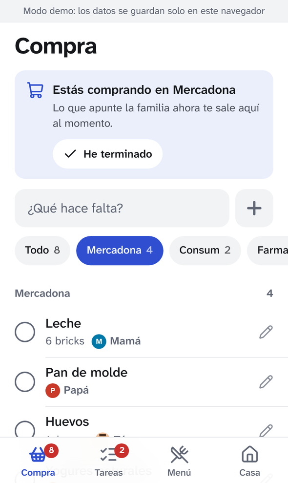
  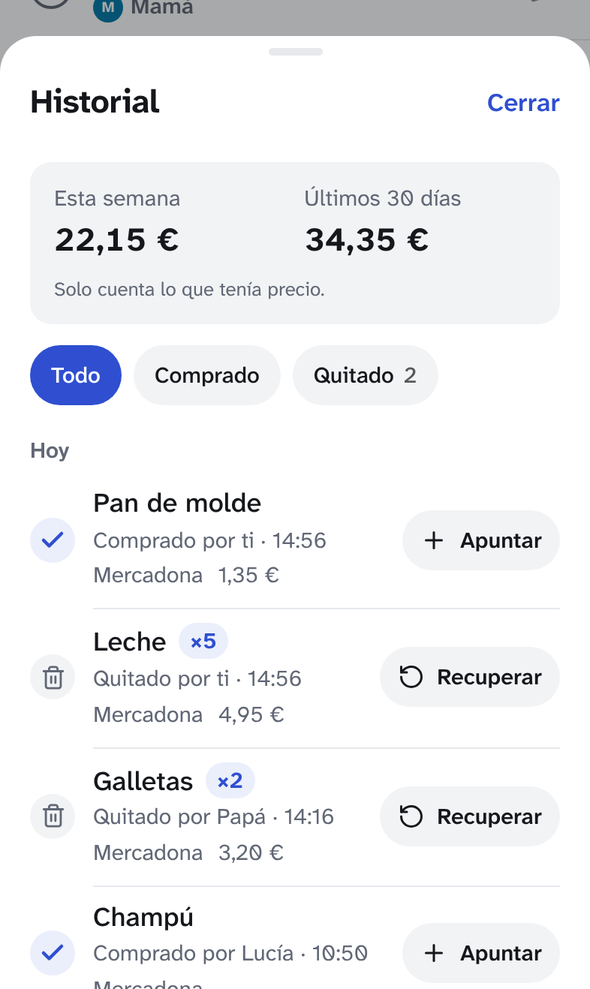
  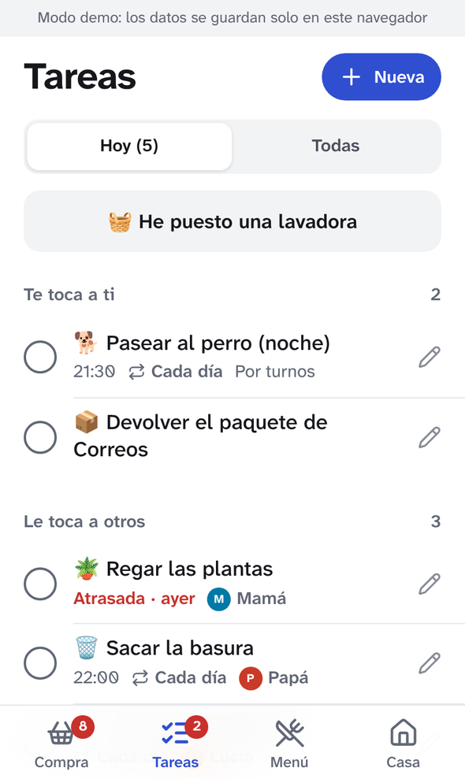
  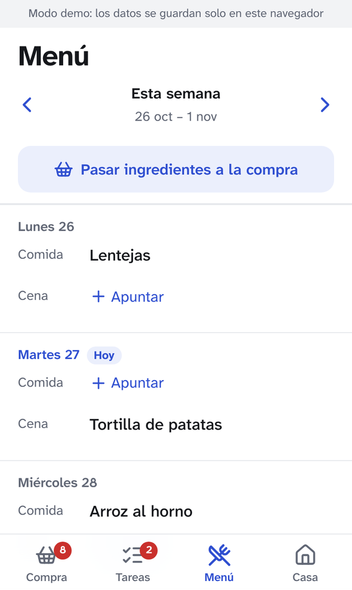
  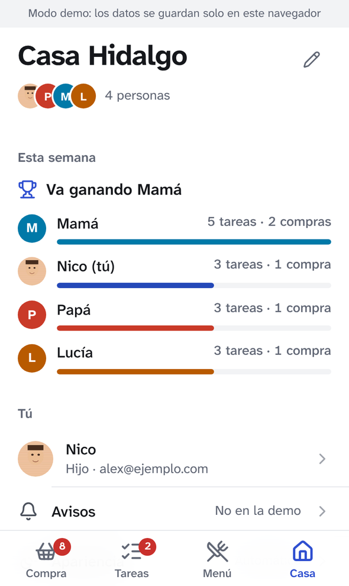
</p>

> Nido nació para mi propia familia y después lo convertí en algo que cualquier casa pueda usar. La interfaz está en castellano.

> **El código de Nido es privado.** Este repositorio es solo la ficha del proyecto. La app está publicada y se puede usar directamente: [nidoapp.web.app](https://nidoapp.web.app) (la demo no necesita cuenta). Si quieres ver el código, escríbeme desde [nicolashidalgo.es](https://nicolashidalgo.es).

## Por qué

En casa, todo pasaba por el grupo de WhatsApp de la familia: «falta leche», «¿quién saca al perro?». Los mensajes se perdían, dos personas compraban lo mismo y nadie se acordaba de a quién le tocaba fregar.

Nido lo sustituye por un único sitio compartido: cualquiera apunta lo que falta, quien está en el supermercado lo ve al momento y lo tacha, y las tareas que se repiten rotan solas. Tenía que poder usarlo mi familia, así que está pensado para letra grande, botones grandes y ningún gesto escondido.

## Funciones

**Lista de la compra**
- Lista en tiempo real compartida por toda la casa y agrupada por tienda (Mercadona, Lidl, la farmacia…).
- Añadir rápido con **selector de cantidad** (− / +, o escribe `1 kg`, `6 bricks`; también vale `2 leche`), sugerencias de lo que sueles comprar y aviso de duplicados.
- **Precio** opcional, que se apunta al comprar (con el botón *Poner precio* del aviso de «comprado», o después desde el historial). Se recuerda el último, así que la lista muestra una estimación por línea y el total de la compra.
- **Foto** opcional para cuando quieres uno en concreto (el desodorante de tal marca): se hace con la cámara o se elige de la galería, se ve en miniatura en la lista y se recuerda para la próxima vez que apuntes ese producto.
- Tachas un producto y desaparece para todos, con unos segundos para deshacer.
- **Historial** de los últimos 30 días: lo que se compró (quién, dónde y a cuánto) y lo que se quitó. Lo quitado se recupera tal cual estaba, lo comprado se vuelve a apuntar con un toque, y suma lo gastado esta semana y este mes.
- **«Voy a comprar»** avisa a la casa, y lo que se apunte mientras estás allí te llega como aviso.
- Lo urgente va arriba del todo y avisa a todos.

**Tareas**
- Asígnalas a una persona, a «quien pueda» o **por turnos** (fregar: hoy tú, mañana tu hermana…).
- Repetición diaria, por días de la semana, semanal o mensual. Las atrasadas destacan.
- Vista de «Hoy» con tus tareas primero y lo que ya ha hecho cada uno.
- Temporizador de la lavadora: dile cuánto dura el programa y te avisa para tender.
- Aviso a la hora de la tarea, a quien le toque.

**Preguntas a la casa**
- Preguntas que se repiten, como *«¿Quién quiere pan para cenar?»*, lanzadas solas los días y a la hora que elijas, para que nadie tenga que preguntar lo mismo cada día por WhatsApp.
- Todos reciben un aviso y responden con un toque; la tarjeta muestra quién ha dicho qué y a quién le falta.
- Cada persona puede quitar la tarjeta de su pantalla con la ✕ (con opción de deshacer), sin afectar a los demás.
- Pueden ir ligadas a un producto: un toque añade *Pan × 3* a la lista, contando los «sí».
- También se pueden mandar preguntas sueltas al momento.

**Menú semanal**
- Comida y cena de cada día, con sus ingredientes. Los platos se recuerdan para la próxima vez.
- Manda los ingredientes de la semana a la lista de la compra con un toque, sin repetir lo que ya está.

**Casa y cuentas**
- Entra con Google o con email y contraseña, y recupera la contraseña por email.
- **Entrar con Face ID** opcional (passkeys / WebAuthn), que se activa en cada dispositivo desde tu perfil. Si falla, Google y el email siguen funcionando.
- Crea una casa o únete a una con un código de 6 caracteres.
- Cada persona elige su nombre, su rol en la familia (madre, hijo, compi de piso…), su foto y su color.
- Temas de color para toda la casa, y por persona modo claro/oscuro y **letra grande**.
- Ranking semanal: cada tarea hecha y cada producto comprado suma un punto.

**Plataforma**
- PWA instalable. Funciona sin conexión (caché persistente de Firestore) y se sincroniza al volver.
- Notificaciones push web, también en iPhone (iOS 16.4 o superior, instalada en la pantalla de inicio).
- Un **modo demo** completo que funciona sin servidor y con datos de ejemplo, para probarla.

<p align="center">
  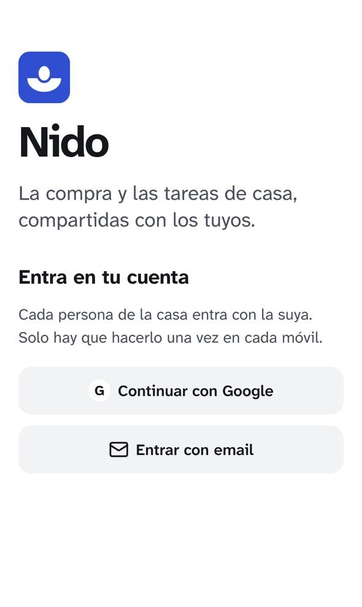
  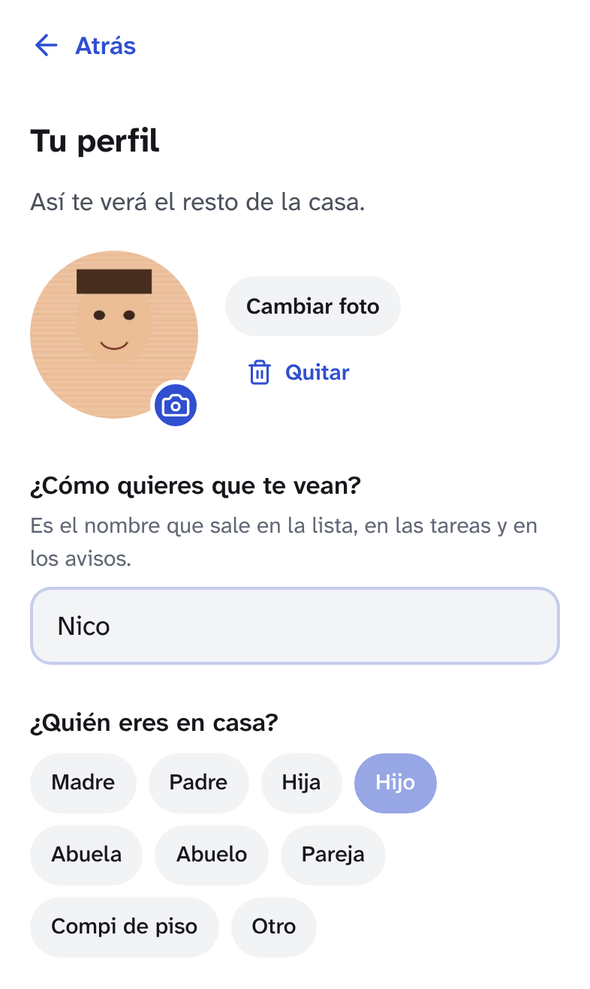
  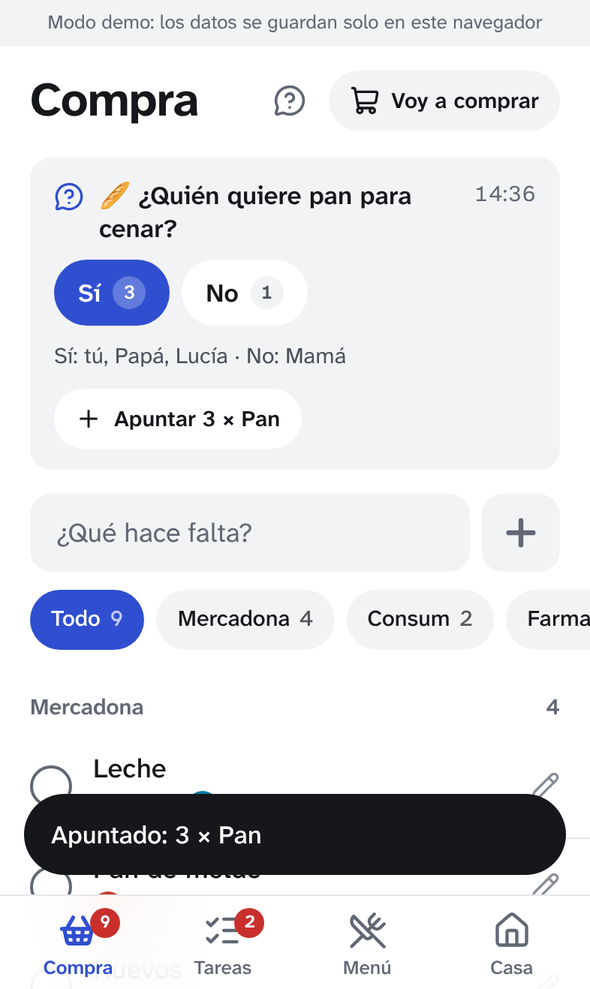
  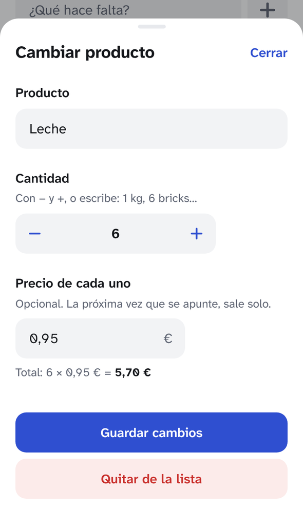
  
  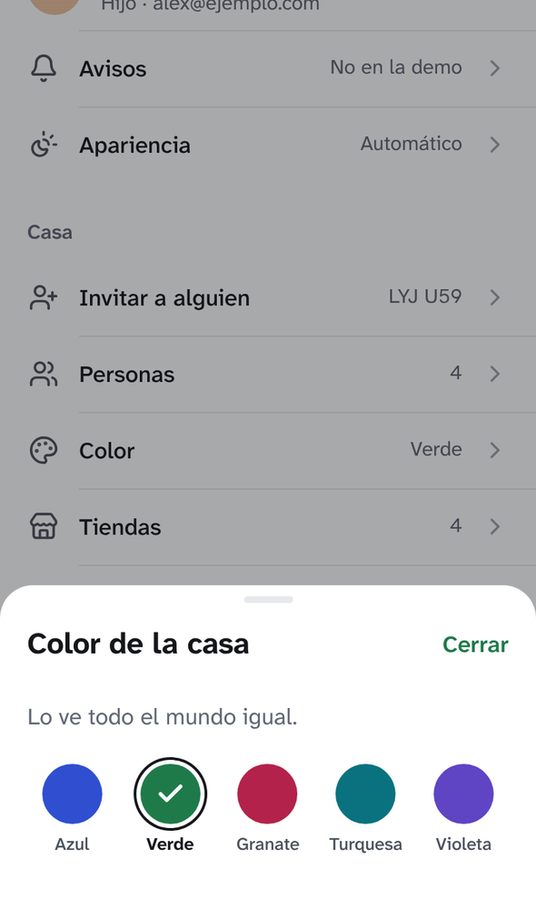
  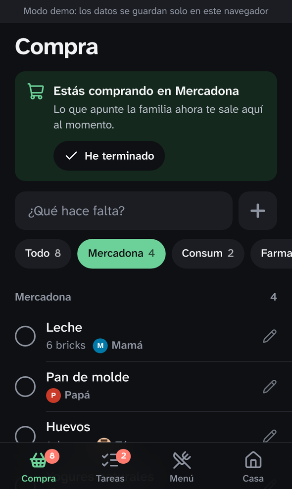
</p>

## Tecnologías

| Capa | Elección |
|---|---|
| Interfaz | React 19, TypeScript, Vite, CSS propio con variables de diseño |
| PWA | `vite-plugin-pwa` (injectManifest) con un service worker de Workbox a medida |
| Acceso | Firebase Authentication (Google, email y contraseña) más passkeys verificadas con SimpleWebAuthn y tokens personalizados de Firebase |
| Datos | Cloud Firestore con caché local persistente y reglas de seguridad |
| Notificaciones | Firebase Cloud Messaging (web push) |
| Lógica de servidor | Cloud Functions para Firebase (2.ª gen.): disparadores de Firestore, funciones invocables y un planificador |
| Alojamiento | Firebase Hosting |
| CI | GitHub Actions: comprobación de tipos y compilación de la app y de las funciones |

## Arquitectura

```
src/
  lib/backend/        types.ts (interfaz) · firebase.ts (real) · local.ts (demo, localStorage)
  lib/actions.ts      todas las escrituras de la app: compra, tareas, turnos, menú, preguntas, casa
  lib/dates.ts        repeticiones, turnos y fechas en castellano
  lib/themes.ts       temas de la casa y preferencias de cada persona
  state/              contexto de React para la casa, notificaciones, avisos y confirmaciones
  screens/            Compra, Tareas, Menú, Casa, Preguntas, acceso y configuración inicial
  sw.ts               service worker: caché sin conexión + push en segundo plano
functions/src/
  index.ts            notificaciones, recordatorios y preguntas programadas
  passkeys.ts         Face ID: registro/acceso con WebAuthn → token personalizado de Firebase
  schedule.ts         «el próximo lunes a las 18:00 en Europe/Madrid», sin errores con el cambio de hora y sin librerías
firestore.rules       reglas de seguridad
```

**Una interfaz de backend, dos implementaciones.** Las pantallas nunca hablan directamente con Firebase. Usan una pequeña interfaz `Backend` (acceso, lectura y escritura de documentos, consultas en vivo, push). `firebase.ts` la implementa con el SDK de Firebase; `local.ts` la implementa con `localStorage`, un inicio de sesión falso y las mismas rutas de documentos. Eso hace que la demo funcione entera sin servidor y que la interfaz se pueda probar fácilmente.

**Modelo de datos**

```
users/{uid}                    → { householdId, prefs: { appearance, text } }
  passkeys/{credentialId}      → { publicKey, counter, device }   (lo escribe solo el servidor)
passkeys/{credentialId}        → { uid }                          (solo servidor)
joinCodes/{CODE}               → { householdId, name }
households/{hid}               → { name, code, theme, stores[], trip, createdBy }
  members/{uid}                → { name, role, color, photo, tokens[], joinedAt }
  items/{id}                   → { name, qty, price, store, urgent, addedBy }
  tasks/{id}                   → { title, assignee, rotation[], due, repeat, remind, nextNotifyAt }
  log/{id}                     → { type: task | buy | removed, title, personId, at, item }
  menu/{lunes AAAA-MM-DD}      → { days: { fecha: { comida, cena } } }
  questions/{id}               → { text, options[], days[], time, item, nextAt, round: { at, answers } }
  photos/{clave del producto}  → { data }   (JPEG pequeño en data URL, ≤ ~110 KB)
  meta/catalog · meta/dishes   → productos habituales (con el último precio) y platos recordados
```

Un miembro *es* una cuenta: el id del documento del miembro es el uid del usuario. Las fotos de perfil se recortan a 256 px en el dispositivo y se guardan como un JPEG pequeño (data URL) dentro del documento del miembro, así que no hace falta Cloud Storage.

**Reglas de seguridad** (`firestore.rules`)
- Solo los miembros de una casa pueden leer o escribir sus datos.
- Solo te haces miembro si has creado la casa o presentas un código válido. Los códigos se consultan de uno en uno, nunca se pueden listar.
- Tu perfil solo lo puedes editar tú. Quien creó la casa puede quitar miembros.
- Los perfiles se validan (longitud del nombre, tamaño de la foto).

**Notificaciones** (Cloud Functions, `europe-west1`)

| Qué pasa | A quién se avisa |
|---|---|
| Alguien pulsa «Voy a comprar» | A todos los demás |
| Se añade un producto mientras alguien está comprando | A quien está comprando |
| Un producto se marca como urgente | A todos los demás |
| Te asignan una tarea | A ti |
| Llega la hora de aviso de una tarea (se comprueba cada 5 min) | A quien le toque |
| Alguien entra en la casa | A todos los demás |
| Se lanza una pregunta (programada o al momento) | A todos, salvo a quien la lanzó |

Los tokens de dispositivos que dejan de funcionar se eliminan solos. Al cerrar sesión se elimina el token del dispositivo, para que quien use el móvil después no reciba tus avisos.

En iPhone, los avisos de una app web instalada en la pantalla de inicio se comportan como los de cualquier otra app, así que también llegan al **Apple Watch** emparejado (con el iPhone bloqueado y el reloj en la muñeca y desbloqueado). Se ajustan en la app Watch › Notificaciones › Nido.

**Entrar con Face ID (passkeys)**

Firebase Authentication no trae passkeys, así que Nido implementa WebAuthn por su cuenta:

1. Con la sesión iniciada, pulsas *Activar Face ID*. Una función invocable crea las opciones de registro (credencial descubrible, verificación de usuario obligatoria); el navegador crea la passkey; la función la verifica con SimpleWebAuthn y guarda la clave pública.
2. En la pantalla de acceso, *Entrar con Face ID* pide al dispositivo cualquier passkey guardada para Nido (sin escribir el email). La función verifica la firma, el reto de un solo uso y el contador, y devuelve un **token personalizado** de Firebase para esa cuenta.
3. Las opciones se piden antes del toque, porque Safari solo abre Face ID directamente desde un gesto del usuario.

Google y el email con contraseña siguen siempre como alternativa. El flujo se probó de principio a fin con un autenticador WebAuthn virtual en Chromium (registro, acceso con credencial descubrible y rechazo de un reto repetido).

**Particularidades del iPhone**
- El push web en iOS solo funciona en PWA añadidas a la pantalla de inicio, y el permiso debe pedirse directamente desde un toque, así que la app lo pide de forma síncrona dentro del manejador del clic.
- Safari y la app instalada no comparten almacenamiento, así que la app pide a los usuarios de iPhone que la instalen primero e inicien sesión dentro de ella.
- El acceso con Google usa una redirección dentro de la app instalada. Como Safari bloquea el almacenamiento de terceros, `authDomain` debe ser el mismo dominio desde el que se sirve la app (Firebase Hosting sirve el gestor de acceso en todos los sitios).

## Notas de diseño

- Interfaz tranquila y con aire de app nativa: fondo blanco, un solo color de acento por casa, listas separadas por líneas finas, sin tarjetas, sombras ni tramas. Los ajustes son una lista corta de filas que abren hojas desde abajo, así cada pantalla se mantiene ligera.
- La letra es [Atkinson Hyperlegible Next](https://www.brailleinstitute.org/freefont/), diseñada para personas con baja visión. El texto va a 17–18 px, las zonas táctiles miden 44–52 px, cada acción tiene su etiqueta y hay una opción de letra grande por persona.
- Los colores de la casa (azul, verde, granate, turquesa y violeta) se comprobaron con contraste WCAG AA sobre blanco, sobre su tono suave y, en modo oscuro, sobre el fondo oscuro. Los colores de las personas se validaron para que se distingan entre vecinos con daltonismo.
- La marca es un huevo en su nido, dibujado con el color de acento de la casa.
- Las interacciones perdonan: al tachar algo se ve tachado un momento, y las acciones destructivas ofrecen deshacer o confirmación.

## Limitaciones e ideas

- **Los sonidos de las notificaciones no se pueden personalizar.** Las apps web en iOS no pueden elegir su propio tono; solo puedes activar o quitar el sonido en *Ajustes › Notificaciones*. Para eso haría falta una app nativa.
- **Las passkeys van ligadas al dominio** de `APP_URL`, así que dejan de funcionar si cambias el sitio de dirección.
- **No hay copias de seguridad automáticas.** Firestore es la única copia de los datos; activa las copias programadas en la consola de Firebase si la casa depende de ello.
- Ideas sin hacer: exportar el historial de compras, gráficos de gasto por tienda y productos recurrentes («leche cada semana»).

## Contacto

Nicolás Hidalgo Salinas · [nicolashidalgo.es](https://nicolashidalgo.es) · [GitHub](https://github.com/n1co2611)

© Nicolás Hidalgo Salinas. Todos los derechos reservados.
